# Fbx2Mdx

<a href="https://github.com/GoldenEggCN/Fbx2Mdx-release/releases/latest"><b>Download latest release</b></a> &nbsp;·&nbsp; <a href="https://goldeneggcn.github.io/Fbx2Mdx-release/">Full introduction</a> &nbsp;·&nbsp; <a href="https://www.hiveworkshop.com/threads/fbx2mdx-easily-convert-fbx-glb-to-wc3-model.373975/">Hive Workshop thread</a>

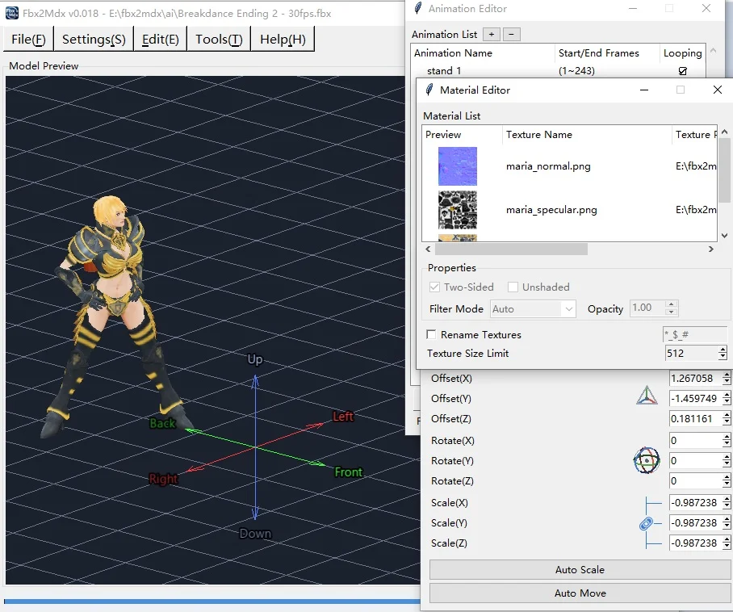

---

Author: GoldenEggCN 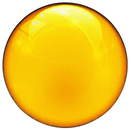

Forum: [Hive Workshop](https://www.hiveworkshop.com/threads/fbx2mdx-easily-convert-fbx-glb-to-wc3-model.373975/)

QQ Group: 181519522

### What is this?

A model format conversion tool.

It can easily convert common model formats such as FBX/GLB into the model format used by Warcraft III.

Easy to get started, one-click operation, no professional tools or plugins required. Excellent compatibility and stability keep you free from all kinds of tricky issues.

It also makes model files more stable, making them easier to transfer and use across various game engines and modeling software.

### Features

Supports FBX , GLB , OBJ and MDX ( Classic, Reforged ) and other model formats.

When exporting, bake animation frames, and preserve the model's rest bind pose. This makes the model file more standardized.

Exported MDX restores smooth weight performance, and automatically adds attachment points and click spheres.

Visually edit offset, rotation, scale and other parameters, as well as recalculate normals.

Quickly rig and skin a model that has no skeleton. Make it able to move.

Merge multiple animation clips. For a properly named skeleton, you can instantly add preset combat animations.

Reduce the model's polygon count. Perform retopology and texture baking on high-poly models with messy topology.

---

## Effect Demo

FBX: 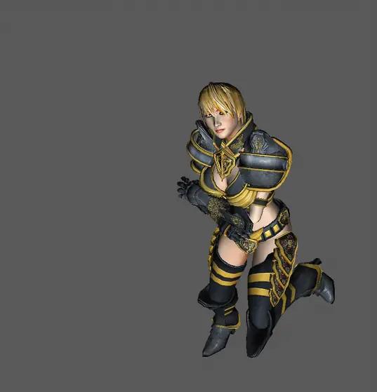 → MDX: 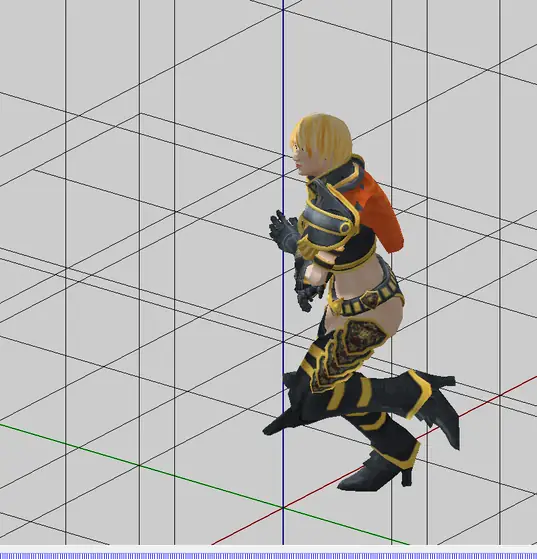

As you can see, even when converted to classic MDX, it still maintains smooth dance movements and poses.

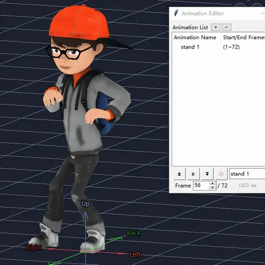 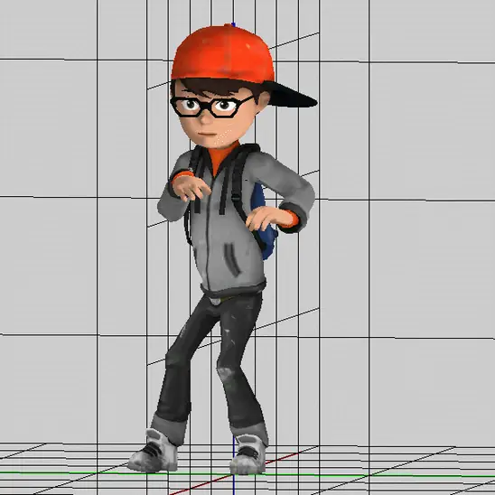

Quickly adjust the model through operations such as translate, rotate, and scale.

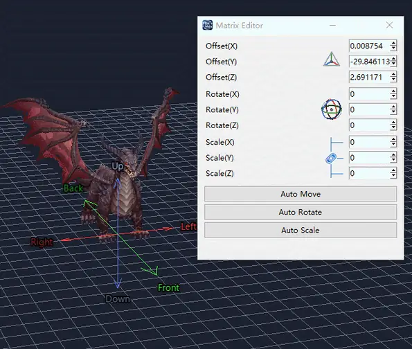 

 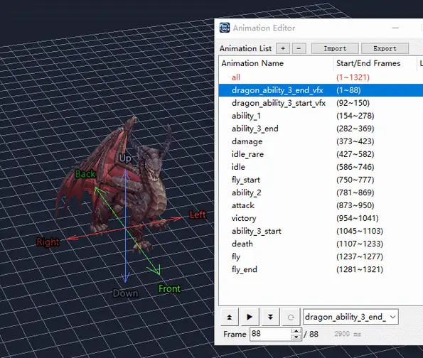

The “**Decimate Mesh**” feature can significantly reduce the vertex count, thereby lessening the game's rendering load.

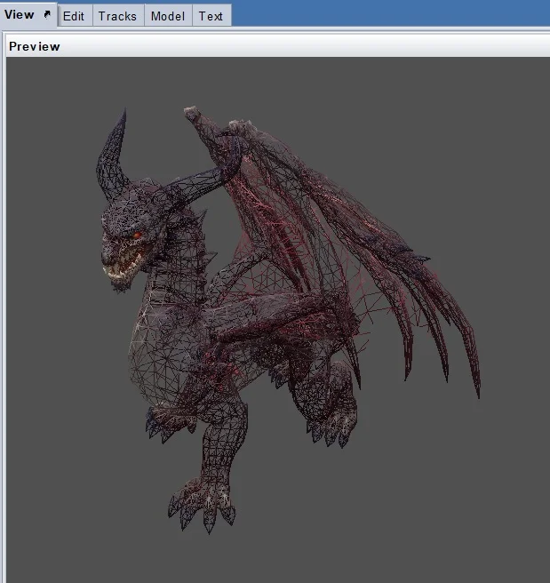 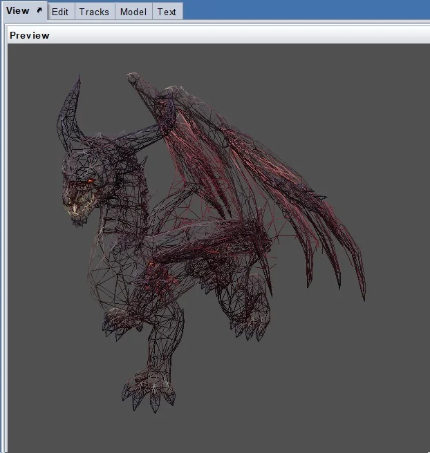

You can also synthesize more animations for her… as long as you have an asset with the same skeleton.

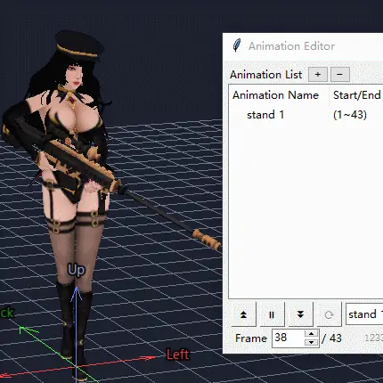 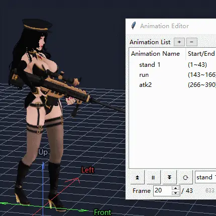 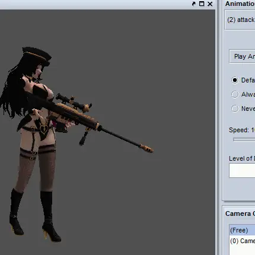

The "**attachment points**" required by the game are automatically identified from the skeleton and added to the model.

Of course, there are also material textures.

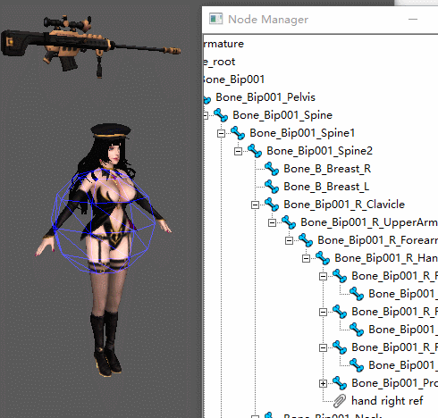 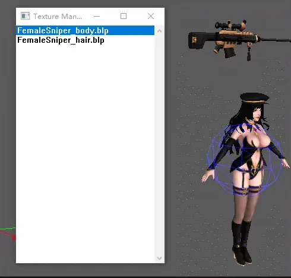

To achieve the mirror effect... just set the scale value to a negative number.

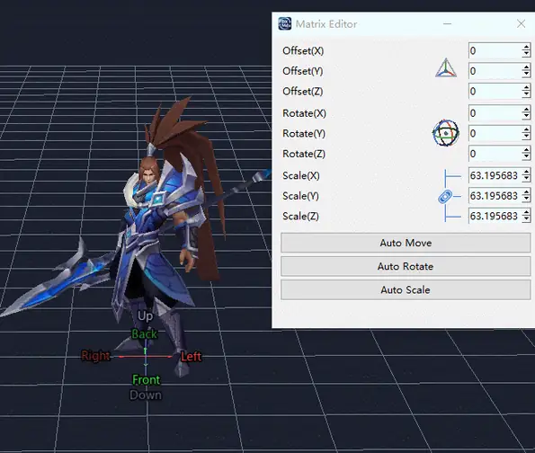

Adjusting the **"Noise Reduction"** and **"Smoothing"** strength of the animation can make the character's movements smoother.

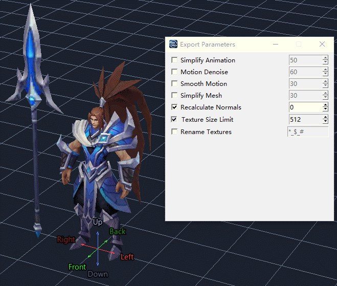

Comparison of effects: Original → Noise Reduction → Noise Reduction & Smoothing

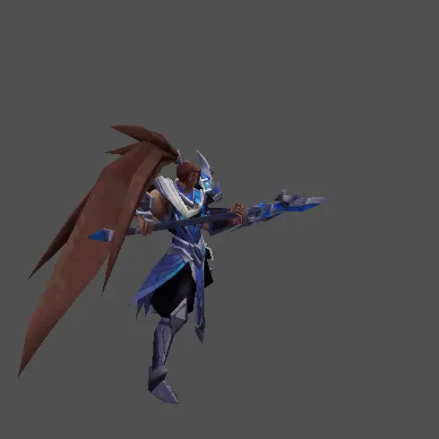 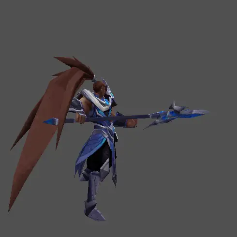 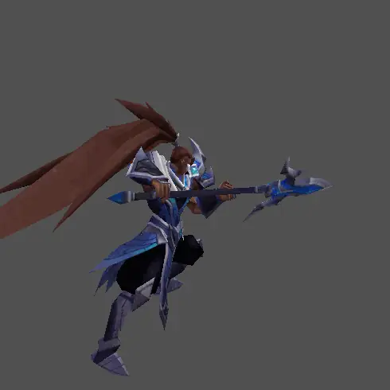

AI-generated models often have messy topology and a high polygon count, which is not conducive to the skinning workflow.

But now you can use this "Retopology and Baking" tool to rebuild this model.

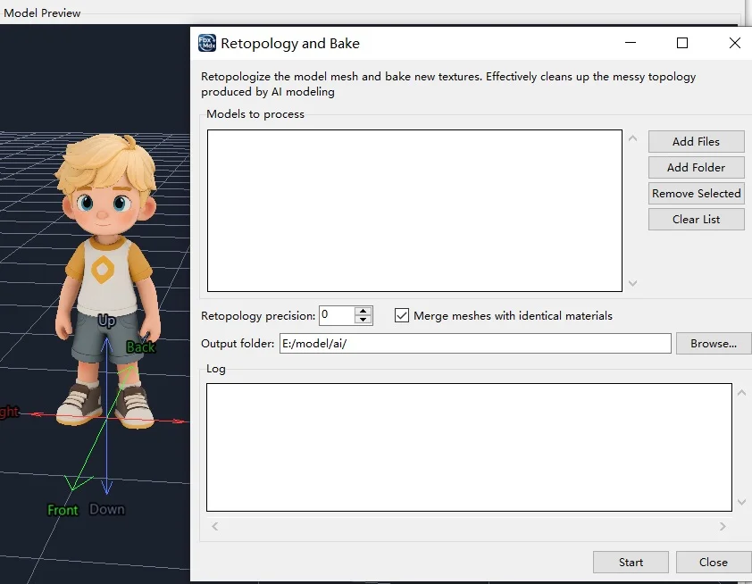

After retopology, the model's vertex count dropped by a full 50%! And the mesh topology is much cleaner too.

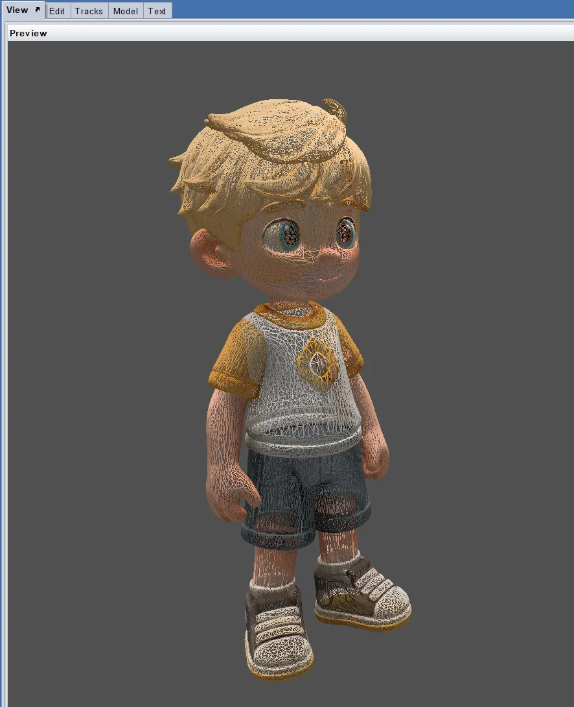 → 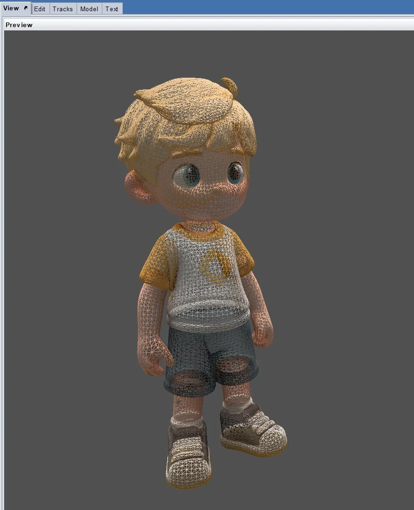

The blocks of color on the texture are also tidier, and you'll find it much easier to paint patterns and color schemes on it.

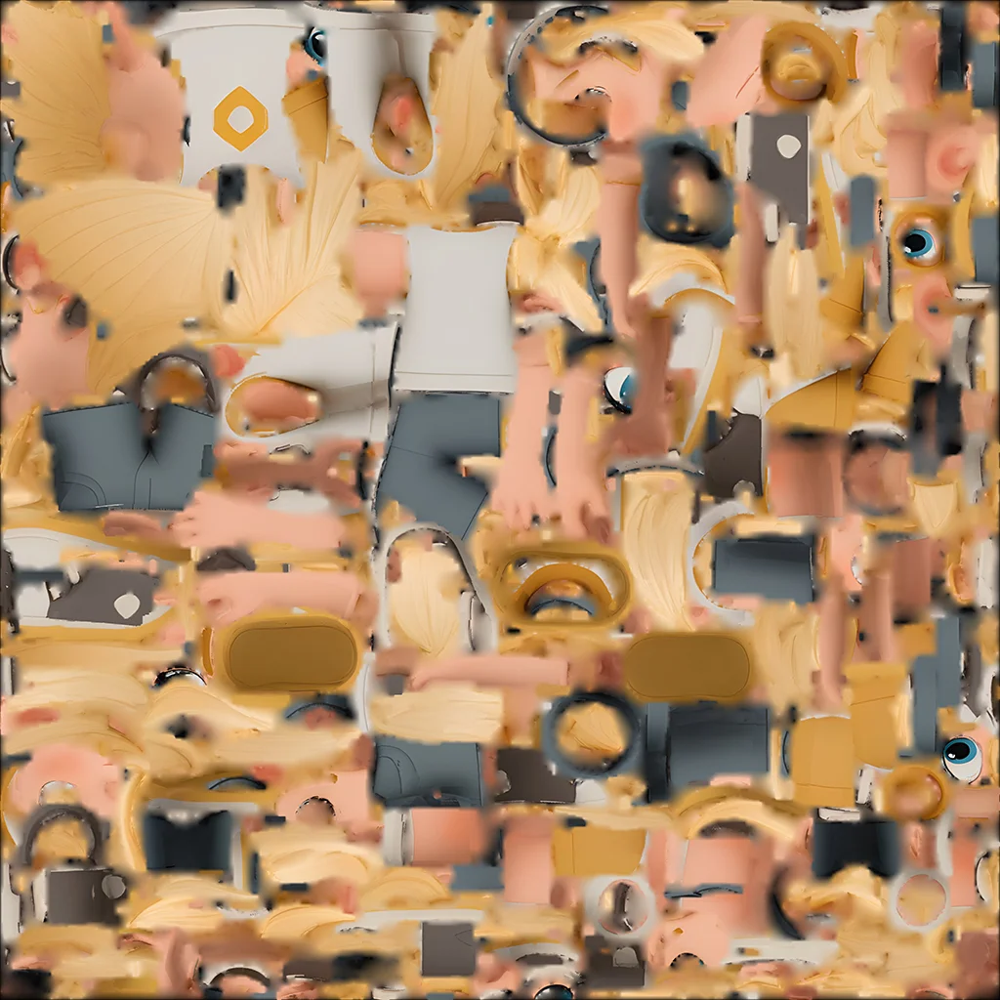 → 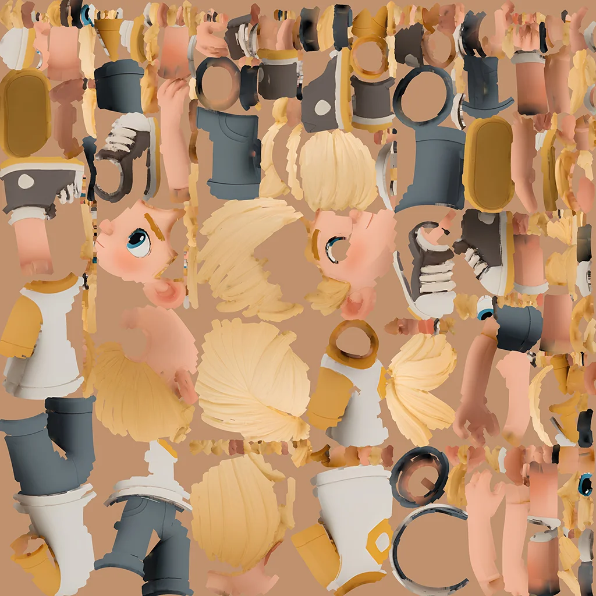

**Fortunately, this process preserves the model's skinning weights and skeletal animation!**

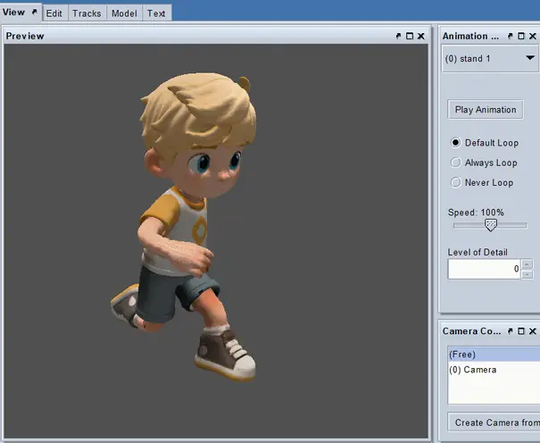

---

### Frequently Asked Questions

Q: Is this software paid?

A: It is completely free. Perhaps in the future only some AI features may be charged for.

Q: Do the converted MDX models come with animations? Can particle effects be converted?

**A: If the original model has animations, they will naturally be preserved in the converted MDX. As for particle effects, they are a product of the game engine and are not stored in the model file, so they cannot be converted.**

Q: Why does this software's conversion feature take a long time, and why do the exported FBX files take up even more disk space?

A: The software bakes all skeletal animations of the model into keyframes, so it can adapt to almost any game engine and fully reproduce the animation effects. This trades time and disk space for compatibility, which is a necessary trade-off.

Q: Someone has already used AI to create a DLL that can read and recognize various Blizzard model assets in-game, so why is a converter still needed?

Answer: Blizzard's model format is very simple and stable. But closed-source formats like FBX are often endlessly variable and very messy, so reading them directly in-game is highly impractical; the only way is to convert them.

Q: How is this converter different from other lightweight MDX converters or plugins?

Answer: It's more like an FBX editor, or rather an "FBX purifier." It turns all kinds of FBX files into more stable versions, so they can flow smoothly between various modeling software and game engines. Therefore, it is not limited to Blizzard's game assets; it has an industrial-grade pipeline and better extensibility.

## Enjoy using it!
